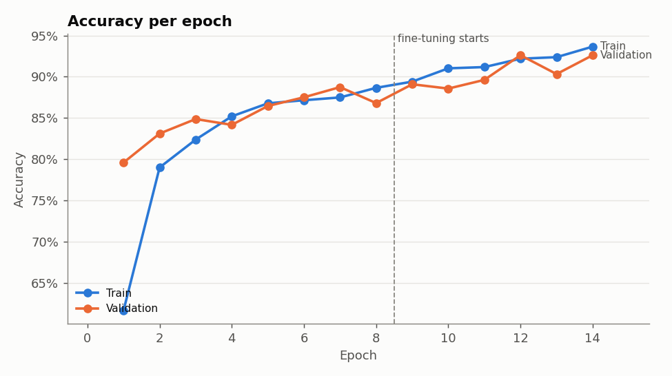
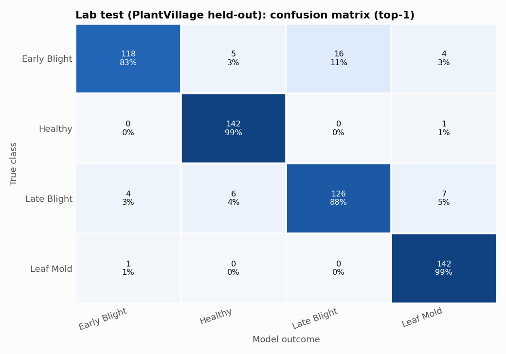
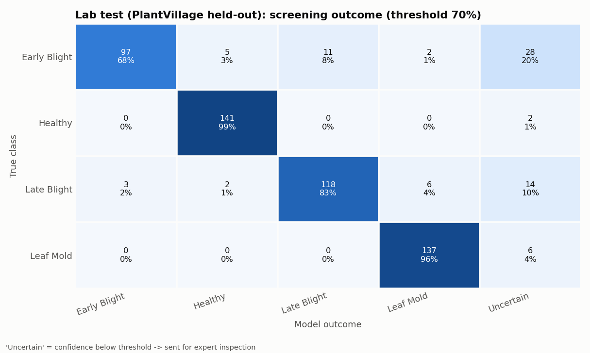
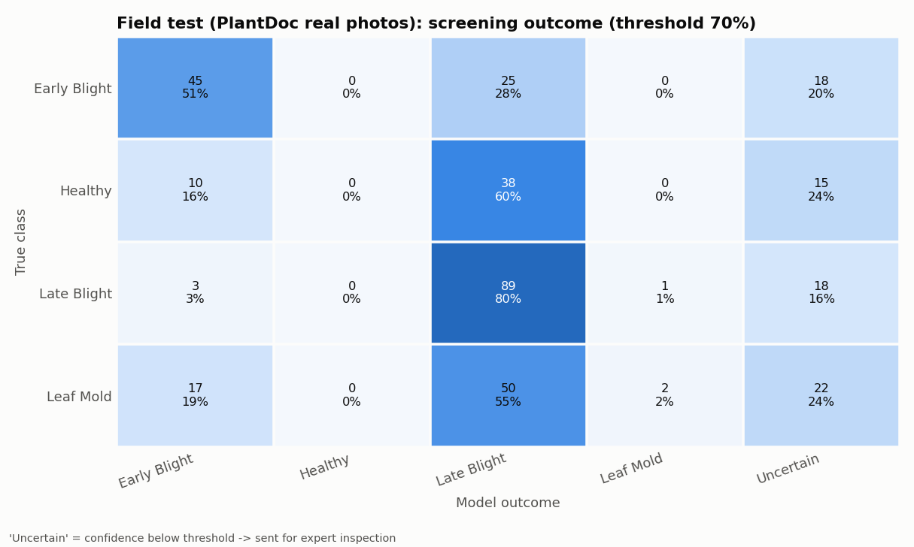
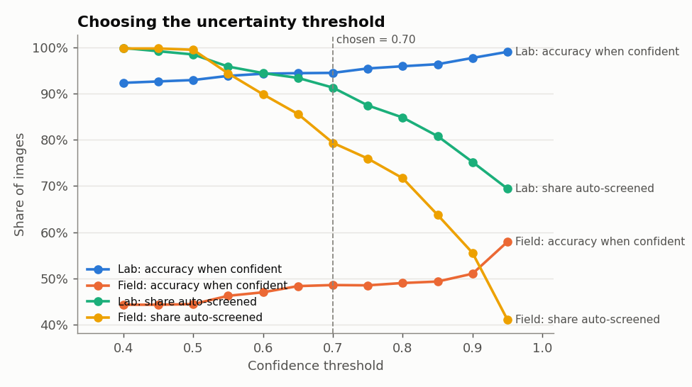
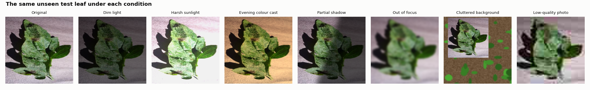
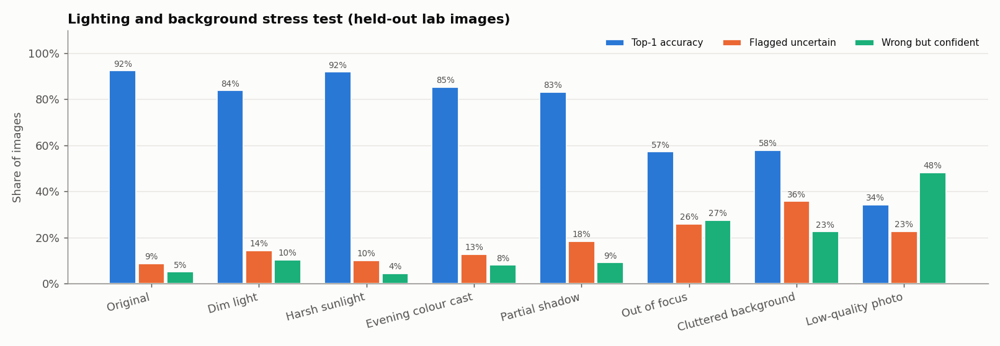

# Crop Leaf Disease Screening Support - Prototype Report

**Scenario:** A farmer cooperative in Telangana receives crop-leaf photos on a
mobile phone. Field officers need an early screening aid to decide which cases
to inspect first.

> **Responsible-use statement.** This prototype is a *screening aid*. It
> **supports, and does not replace,** advice from agricultural experts. It can be
> wrong, especially on real field photos (see Section 5). No spraying, uprooting
> or other treatment decision should be made from its output alone. Every
> "disease" or "uncertain" result must be checked by a field officer or
> plant-pathology expert.

---

## 1. Scope

| Item | Choice | Why |
|---|---|---|
| Crop | **Tomato** | Widely grown in Telangana; good public data exists |
| Classes | **Healthy, Early Blight, Late Blight, Leaf Mold** | Common fungal/oomycete diseases with visible leaf symptoms |
| Training data | PlantVillage (public), 665 images per class | Clean, labelled, balanced |
| Unseen test data | 572 held-out PlantVillage images + 353 PlantDoc field photos + 389 field photos of *other* diseases | Tests both "same-style" and "real-world" performance |

## 2. How it works (simple version)

1. **Photo in** - the image is resized to 224 x 224 pixels.
2. **MobileNetV2** - a network pre-trained on 1.4 million everyday photos
   turns the image into 1,280 numbers describing edges, colours and textures.
3. **New final layer** - trained by us, it turns those numbers into 4
   probabilities, e.g. `Late Blight 0.91, Early Blight 0.06, Healthy 0.02, Leaf Mold 0.01`.
4. **Uncertainty rule** - if the highest probability is **below 0.70**, the app
   shows **"Uncertain - expert inspection required"** instead of a class.

**Training** used *transfer learning* in two phases:

- Phase 1 (8 epochs): MobileNetV2 frozen, only the new layer learns.
  Validation accuracy rose from 79.6% to 88.7%.
- Phase 2 (6 epochs): the last 40 MobileNetV2 layers were gently fine-tuned
  (learning rate 0.00001). Validation accuracy reached **92.6%**.
- Random flips, rotations, zoom, brightness and contrast changes were applied
  during training to make the model less sensitive to how a photo is taken.



### Example of the screening rule

| Photo | Model's best guess | Confidence | What the app shows |
|---|---|---|---|
| `samples/lab_early_blight_1.jpg` | Early Blight | 99.7% | **Early Blight** - priority 2 |
| `samples/lab_healthy_1.jpg` | Healthy | 100.0% | **Healthy** - priority 3 |
| `samples/field_healthy_1.jpg` | Early Blight | 60.0% | **Uncertain - expert inspection required** - priority 1 |
| `samples/lab_late_blight_1.jpg` | Late Blight | 58.9% | **Uncertain - expert inspection required** - priority 1 |

The batch tab sorts uploads by priority: *Uncertain* and *Late Blight*
(spreads very fast) first, then other diseases, then healthy leaves.

---

## 3. Results on unseen test images

### 3a. Lab test - 572 held-out PlantVillage images (never used in training)

Overall top-1 accuracy: **92.3%**

| Class | Precision | Recall | F1 | Images |
|---|---|---|---|---|
| Early Blight | 0.959 | 0.825 | 0.887 | 143 |
| Healthy | 0.928 | 0.993 | 0.959 | 143 |
| Late Blight | 0.887 | 0.881 | 0.884 | 143 |
| Leaf Mold | 0.922 | 0.993 | 0.956 | 143 |
| **Macro average** | **0.924** | **0.923** | **0.922** | 572 |



Most mistakes are **Early Blight vs Late Blight** (16 early-blight leaves called
late blight). Both cause brown lesions, so this is expected.

**With the 70% uncertainty rule:**

| | Value |
|---|---|
| Sent to "Uncertain" (expert) | 50 of 572 (8.7%) |
| Accuracy on the confident predictions | **94.4%** |
| Mistakes caught by the rule (flagged uncertain) | 15 |
| Mistakes still made confidently | 29 |



### 3b. Field test - 353 real field photos (PlantDoc)

These photos come from a different source: leaves on the plant, soil and other
leaves in the background, sunlight, shadows, hands, watermarks.

Overall top-1 accuracy: **44.5%** (vs 92.3% on lab photos)

| Class | Precision | Recall | F1 | Images |
|---|---|---|---|---|
| Early Blight | 0.514 | 0.614 | 0.560 | 88 |
| Healthy | 1.000 | 0.016 | 0.031 | 63 |
| Late Blight | 0.408 | 0.883 | 0.558 | 111 |
| Leaf Mold | 0.571 | 0.044 | 0.082 | 91 |



What this means:

- The model **almost never says "Healthy" on field photos** (1 of 353). Healthy
  field leaves are mostly called Late Blight. So in the field it **over-flags**:
  good for not missing disease, bad for wasting inspection visits.
- **No diseased field leaf was cleared as "Healthy"** after the uncertainty rule
  (column "Healthy" is 0 for every disease row). This is the safer direction of
  error for a screening tool.
- Only 20.7% of field photos were flagged uncertain, while 144 were wrong *and*
  confident. **The confidence score alone is not a reliable safety net on
  photos that look different from the training data.**

### 3c. Diseases the model never learned - 389 field photos

Septoria leaf spot, bacterial spot, mosaic virus, yellow leaf curl virus.
The correct behaviour is "Uncertain".

| Disease (not in training) | Images | Flagged uncertain |
|---|---|---|
| Septoria leaf spot | 150 | 27% |
| Bacterial spot | 110 | 23% |
| Mosaic virus | 54 | 26% |
| Yellow leaf curl virus | 75 | 16% |

Only about 1 in 4 were flagged. The rest were confidently called Early or Late
Blight (practically never "Healthy"), so they would still be sent for
inspection, but with the **wrong disease name**. A 4-class model is forced to
pick one of the 4 classes it knows.

### 3d. Choosing the threshold

| Threshold | Lab: share auto-screened | Lab: accuracy when confident | Field: share auto-screened | Field: accuracy when confident |
|---|---|---|---|---|
| 0.50 | 98.4% | 92.9% | 99.4% | 44.4% |
| 0.60 | 94.4% | 94.3% | 89.8% | 47.0% |
| **0.70 (chosen)** | **91.3%** | **94.4%** | **79.3%** | **48.6%** |
| 0.80 | 84.8% | 95.9% | 71.7% | 49.0% |
| 0.90 | 75.2% | 97.7% | 55.5% | 51.0% |



0.70 keeps about 9 in 10 lab-quality photos automatic while sending the least
sure ones to experts. A higher threshold sends more photos to experts but
barely improves field accuracy - the problem in the field is the data, not the
threshold. The cooperative can change `CONFIDENCE_THRESHOLD` in `src/config.py`.

---

## 4. Lighting and background stress test

The same 572 held-out lab images were changed to imitate real phone photos,
then re-tested. ("Wrong but confident" = wrong answer with confidence >= 70%.)



| Condition | Accuracy | Flagged uncertain | Wrong but confident |
|---|---|---|---|
| Original | 92.3% | 8.7% | 5.1% |
| Harsh sunlight (brighter, washed out) | 91.8% | 10.0% | 4.4% |
| Evening colour cast (warm, orange light) | 85.1% | 12.8% | 8.0% |
| Dim light | 83.7% | 14.3% | 10.3% |
| Partial shadow across the leaf | 83.0% | 18.4% | 9.1% |
| Cluttered soil-and-grass background | 57.9% | 35.7% | 22.6% |
| Out of focus (blur) | 57.2% | 25.9% | 27.4% |
| Low-quality, heavily compressed photo | 34.3% | 22.7% | 48.3% |



- **Lighting** changes cost 1-9 points. Training-time brightness and contrast
  augmentation helped here.
- **Background clutter** and **blur** roughly halve accuracy.
- **Heavy compression** (e.g. a photo forwarded many times on a messaging app)
  is the worst case: the model is *wrong and confident* about half the time.

---

## 5. Limitations

**Dataset**
- PlantVillage photos were taken in a lab: one detached leaf, plain grey
  background, even lighting. The model partly learned *"plain background ->
  this kind of photo"*, which is why field accuracy falls to 44.5%.
- No photos from Telangana: local tomato varieties, soil colours, sunlight and
  phone cameras are not represented.
- PlantVillage contains several photos of the same leaf from different angles,
  and the split was random, so the lab test score is probably **optimistic**.
- PlantDoc labels come from web images and contain some noise (some "leaf"
  photos are whole plants), so the field score is a rough estimate.
- Only 4 classes. Real fields have many more problems (other diseases, pests,
  nutrient deficiency, herbicide damage, several diseases on one leaf).

**Lighting**
- Dim light, evening colour cast and shadows reduce accuracy by 7-9 points.
- Very bright light is handled well; very dark or blurry photos are not.

**Background**
- Soil, grass, hands, stems and other leaves confuse the model. It works best
  with **one leaf, filling most of the frame, on a plain background**.

**Model**
- Softmax confidence is not a calibrated probability, and it is often high
  even when the photo is unlike anything in training. The uncertainty rule
  helps on lab-style photos but is weak protection in the field.

## 6. Recommendations before real use

1. **Photo guideline for farmers:** one leaf, daylight but not direct sun,
   place it on a plain sheet of paper, hold the phone steady, send the
   original photo (not a forwarded/compressed copy).
2. **Collect and label 100-200 local photos per class** with field officers,
   and fine-tune on them. This is the single biggest improvement.
3. Add an **"Other / not tomato"** class and an out-of-distribution check.
4. Track every case the app flags and what the expert decided, to measure real
   accuracy over time.

## 7. Reproducing the results

```bat
python run_all.py      :: download data, train, evaluate, stress test
python app.py          :: start the upload-and-predict interface
```

All numbers in this report come from `results/metrics.json`,
`results/stress_test.json` and `results/training_history.json`.

---

**Again: this tool supports, and does not replace, agricultural expert advice.**
